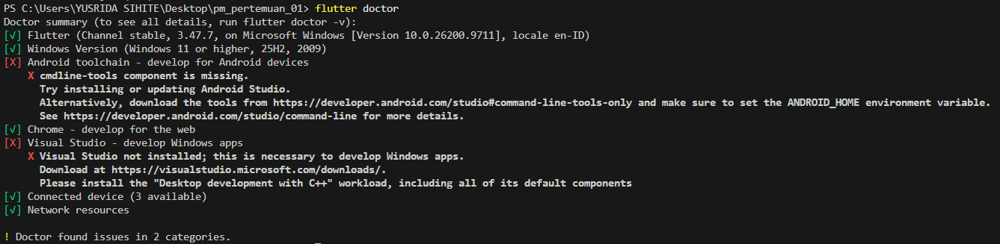
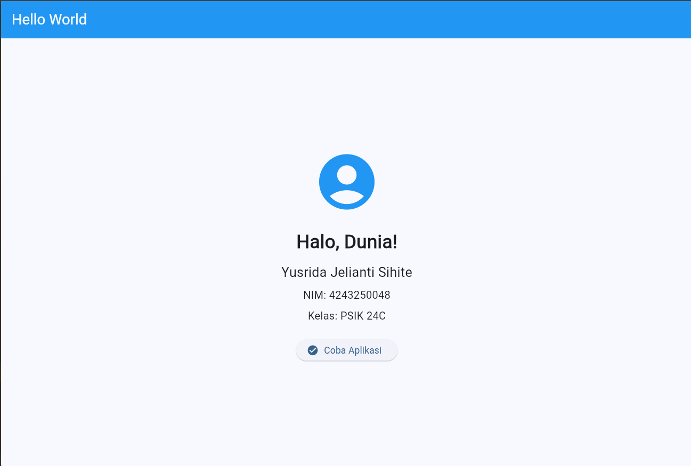

# Pemrograman Mobile - Pertemuan 1

## A. Identitas

- **Nama:** Yusrida Jelianti Sihite
- **NIM:** 4243250048
- **Kelas:** PSIK 24C
- **Mata Kuliah:** Pemrograman Mobile
- **Tugas:** Setup Environment dan Aplikasi Hello World Flutter

## B. Versi Flutter

Pengembangan aplikasi ini menggunakan Flutter sebagai framework untuk membangun aplikasi lintas platform.

Untuk mengetahui versi Flutter yang digunakan, jalankan perintah berikut pada terminal VS Code:

```bash
flutter --version
```

Salin output versi Flutter yang sebenarnya ke bagian ini sebelum mengumpulkan tugas.

## C. Screenshot Flutter Doctor

Screenshot berikut digunakan untuk mendokumentasikan hasil pemeriksaan konfigurasi Flutter dan perangkat pengembangan.



**Keterangan:** Screenshot menampilkan hasil pemeriksaan `flutter doctor` pada lingkungan pengembangan yang digunakan.

## D. Screenshot Aplikasi Hello World

Aplikasi Hello World dibuat menggunakan Flutter dan bahasa pemrograman Dart. Aplikasi menampilkan nama mahasiswa, NIM, kelas, ikon, serta tombol interaktif.



**Fitur aplikasi:**
- Menampilkan nama, NIM, dan kelas mahasiswa.
- Menggunakan `AppBar` sebagai bagian judul aplikasi.
- Menggunakan widget `Icon` sebagai elemen visual tambahan.
- Menggunakan `ElevatedButton` sebagai tombol interaktif.
- Menampilkan pesan melalui `SnackBar` ketika tombol ditekan.

## E. Kendala dan Solusi

### Kendala 1: Menjalankan aplikasi Flutter

**Kendala:** Ketika menjalankan perintah `flutter run`, terminal menampilkan beberapa pilihan perangkat, yaitu Windows, Chrome, dan Edge. Hal ini membuat saya perlu menentukan perangkat yang akan digunakan untuk menjalankan aplikasi.

**Solusi:** Saya memilih Chrome dengan memasukkan nomor perangkat yang sesuai pada terminal. Dengan demikian, aplikasi dapat dijalankan melalui browser tanpa harus menggunakan emulator Android.

### Kendala 2: Memahami konfigurasi dan struktur project Flutter

**Kendala:** Pada awal pengerjaan, saya perlu memahami struktur folder project Flutter, fungsi file `main.dart`, serta cara menjalankan aplikasi melalui terminal.

**Solusi:** Saya mempelajari fungsi file utama, menyesuaikan kode pada `lib/main.dart`, dan menggunakan perintah `flutter pub get` untuk memeriksa serta mengambil dependensi project sebelum menjalankan aplikasi.

## F. Esai: Native, Hybrid, dan Cross-platform

Pengembangan aplikasi mobile dapat dilakukan menggunakan pendekatan native, hybrid, dan cross-platform. Ketiganya memiliki perbedaan dalam teknologi yang digunakan, proses pengembangan, dan pemeliharaan aplikasi.

Aplikasi native dikembangkan khusus untuk sistem operasi tertentu. Sebagai contoh, aplikasi Android dapat dibuat menggunakan Kotlin. Pendekatan ini cocok untuk aplikasi yang membutuhkan integrasi mendalam dengan perangkat, seperti aplikasi kamera atau aplikasi yang memanfaatkan sensor ponsel secara intensif. Namun, pengembangan untuk Android dan iOS biasanya memerlukan basis kode yang berbeda.

Aplikasi hybrid menggabungkan teknologi web, seperti HTML, CSS, dan JavaScript, dengan pembungkus agar aplikasi dapat dipasang pada perangkat mobile. Contohnya adalah aplikasi katalog produk sederhana yang menggunakan kembali antarmuka web. Pendekatan ini dapat mempermudah pemanfaatan teknologi web, tetapi performa dan integrasi perangkat perlu diperhatikan sesuai kebutuhan aplikasi.

Sementara itu, cross-platform memungkinkan pengembang menggunakan satu basis kode untuk membangun aplikasi pada beberapa platform. Salah satu contohnya adalah Flutter yang menggunakan bahasa Dart. Pendekatan ini cocok untuk aplikasi pencatatan keuangan mahasiswa yang ingin tersedia di Android dan iOS dengan tampilan yang relatif konsisten.

Menurut saya, pemilihan pendekatan harus disesuaikan dengan kebutuhan aplikasi, kemampuan tim, biaya pemeliharaan, dan fitur perangkat yang diperlukan. Untuk proyek pembelajaran ini, Flutter menjadi pilihan yang tepat karena membantu saya mempelajari pengembangan aplikasi mobile lintas platform melalui satu basis kode.
